<!-- HERO BANNER -->

<!-- QUICK TELEMETRY BADGES -->

  
  
  

---

### ⚡ Telemetry & Diagnostics

  

### 🛠️ Technical Arsenal

| Domain | Weaponry & Stack |
| :--- | :--- |
| **Languages** | `TypeScript` `JavaScript` `Python` `C++` `SQL` |
| **Frontend Engineering** | `React` `Next.js` `TailwindCSS` `Zustand` `Framer Motion` |
| **Backend & Microservices** | `Node.js` `Express` `FastAPI` `REST` `GraphQL` `WebSockets` |
| **Data & Cache Systems** | `PostgreSQL` `MongoDB` `Redis` `Prisma ORM` |
| **Cloud & DevOps** | `Docker` `GitHub Actions (CI/CD)` `Linux / Bash` `Vercel` `AWS` |

 

<!-- ICONS ROW -->

  

---

### 📊 Real-Time Signal & Heatmap

  

<!-- SNAKE ANIMATION -->
<picture>
  <source media="(prefers-color-scheme: dark)" srcset="https://raw.githubusercontent.com/sachin2711-code/sachin2711-code/output/github-contribution-grid-snake-dark.svg">
  <source media="(prefers-color-scheme: light)" srcset="https://raw.githubusercontent.com/sachin2711-code/sachin2711-code/output/github-contribution-grid-snake.svg">
  
</picture>

---

### 🌐 Direct Transmission

  
  
  

  

